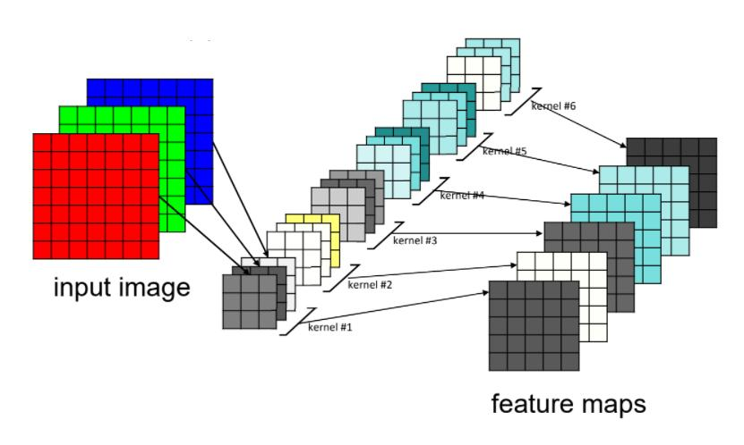
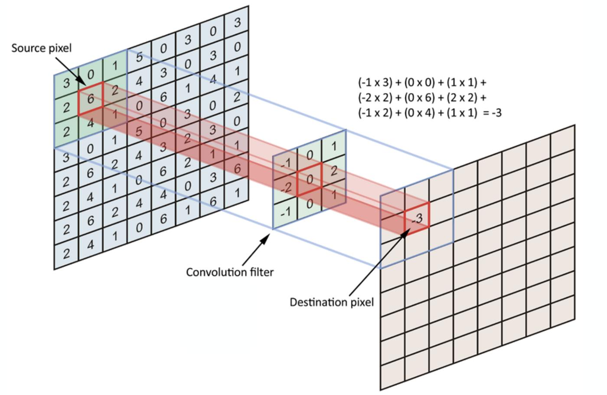
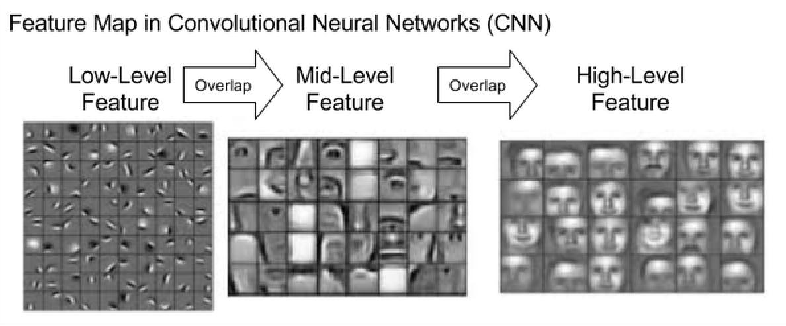
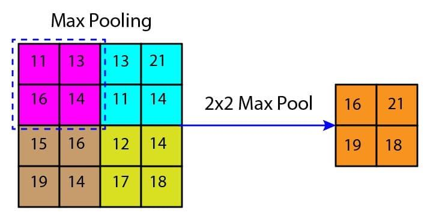
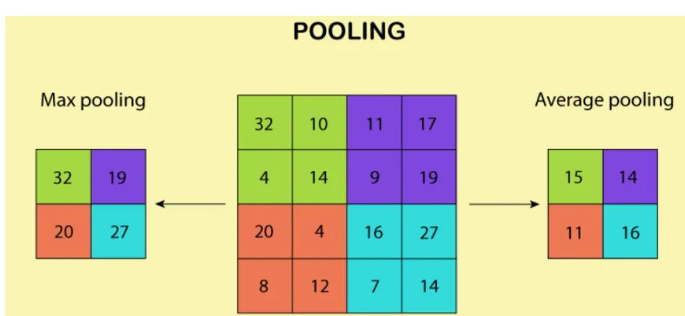
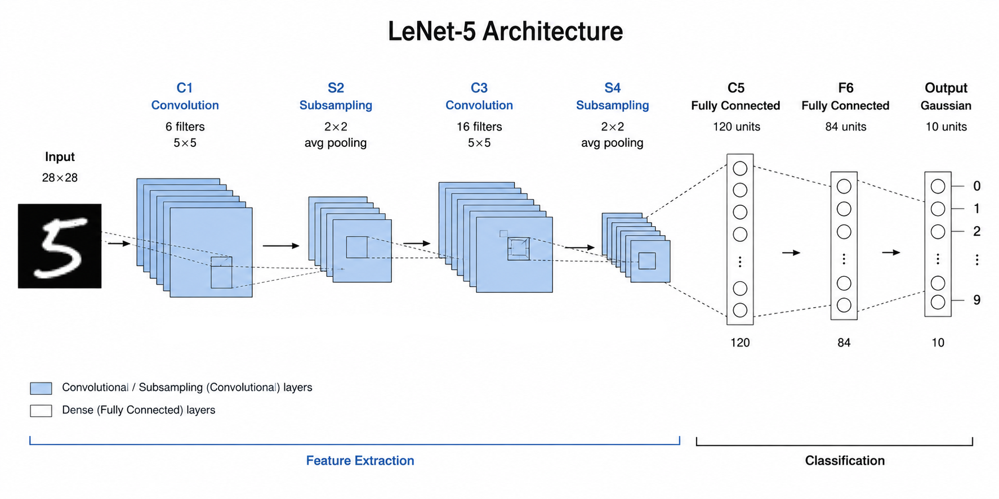
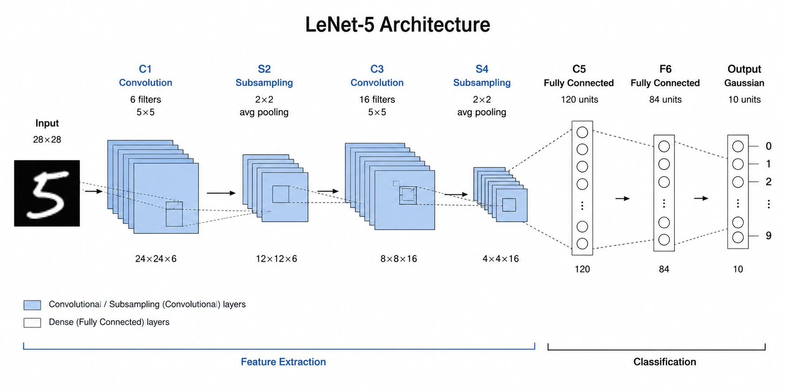
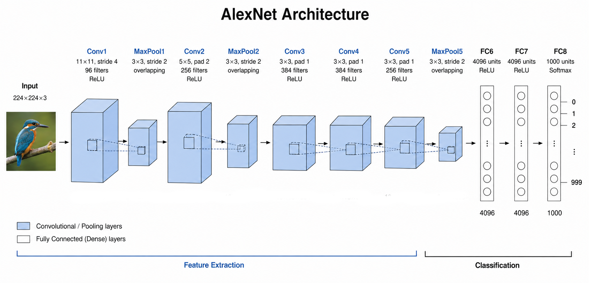
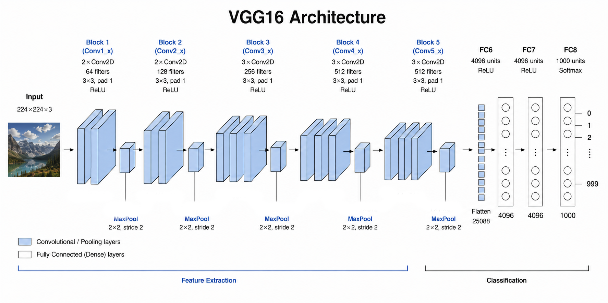
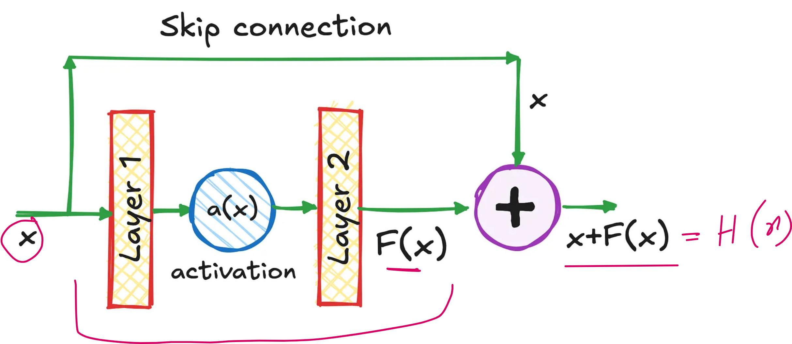

# Эра классики. Фундамент компьютерного зрения: свёрточные сети и ранние архитектуры

---

# Затронем такие темы как:

- Почему появились свёрточные нейронные сети (CNN)
- Как работают свёртки, пулинг и рецептивные поля
- Эволюцию архитектур:
  - LeNet
  - AlexNet
  - VGG
  - Inception (GoogLeNet)
  - ResNet
- Почему ResNet стал основой большинства современных CV-моделей

---

# Исторический контекст
##

До ~2012 года компьютерное зрение в основном строилось на ручных признаках:
- SIFT. Находит характерные точки изображения и описывает локальную область вокруг каждой точки. Устойчив к изменению масштаба и повороту, относительно устойчив к изменению освещения и ракурса
- SURF. Ускоренная альтернатива SIFT. Использует приближённые вычисления на основе матрицы Гессе и фильтров, напоминающих гауссовы производные
- HOG. Глобальное описание формы объекта. Разбивает изображение на ячейки, вычисляет направления градиентов и формирует гистограммы

**Типичный pipeline:** Изображение → Ручные признаки → SVM / Random Forest → Классификация

**Главная проблема:** признаки создавал человек, а не обучались автоматически

Появление глубоких CNN позволило обучать признаки напрямую из данных

---

# Почему обычные нейронные сети до CNN плохо работают с изображениями
##

Предположим:

> Изображение: 224×224×3

Количество входов:

> 224 × 224 × 3 = 150 528

Даже один скрытый слой на 1000 нейронов требует:

> 150 528 × 1000 ≈ 150 млн параметров

**Проблемы:**
- огромное число параметров
- переобучение
- отсутствие учёта пространственной структуры

---

# Свёрточная операция
##

 

Свёртка - это маленький фильтр, который "скользит" по изображению

Например:
> 3×3 фильтр

ищет:
- границы
- углы
- текстуры

---

# Формально

 

Пусть есть изображение $I(x,y)$ и ядро $K(x,y)$

Тогда

$$
g(x,y)=
\sum_{i=-a}^{a}
\sum_{j=-b}^{b}
I(x-i,y-j)K(i,j)
$$ 

где: $(2a+1)$ - ширина ядра; $(2b+1)$ - высота ядра; $g(x,y)$ - результат свертки (Feature Map)

---

# Визуальное представление

---

# Визуальное представление

---

# Слои, расположение

 

**Что изучают первые слои (shallow layers)?** Обычно это базовые, низкоуровневые признаки:
- грани
- углы
- резкие переходы цвета
- простые текстуры

 

**Что изучают глубокие слои (depp layers)?** Сложные высокоуровневые признаки, собирают их в объекты или части объектов:
- глаз
- колесо
- уши животного

---

# Слои, расположение

---

# Типы слоев, используемые в CNN

 

Конволюционные нейронные сети строятся из слоев, каждый из которых выполняет специфическую задачу по извлечению и обработке информации. Разновидности слоев делятся на три основные категории:

1. Извлечение признаков (Convolutional Layers)
2. Уменьшение размерности (Pooling Layers)
3. Финальные MLP Слои (Fully Connected Layers)

---

# Слои извлечение признаков / Convolutional Layers

 

### Суть: 

Основные слои, которые применяют фильтры (ядра) для сканирования входного изображения и создания карты признаков.

 

### Зачем нужны:

1. Извлечение локальных особенностей. Они обучаются находить простые паттерны (грани, углы, текстуры) на небольших участках изображения

2. Создание иерархии. Выход одного слоя становится входным для следующего, где извлекаются более сложные и абстрактные признаки (например, сначала края, потом формы, потом объекты)

---

# Слои уменьшение размерности / Pooling Layers

 

### Суть: 

Слои, которые берут информацию из области и делают ее компактнее. Наиболее распространены Max Pooling (выбор максимального значения) и Average Pooling (вычисление среднего)

Пример MaxPooling:
$
\begin{bmatrix}
1 & 6 \\
7 & 2
\end{bmatrix}
→
\begin{bmatrix}7\end{bmatrix}
$; и пример AvgPooling:
$
\begin{bmatrix}
1 & 6 \\
7 & 2
\end{bmatrix}
→
\begin{bmatrix}4\end{bmatrix}
$

 

### Зачем нужны:

1. Снижение вычислительной нагрузки. Уменьшают пространственные размеры карт признаков, что снижает объём последующих вычислений и, в зависимости от архитектуры, потребление памяти
2. Устойчивость к сдвигам (Translation Invariance). Позволяют сети быть менее чувствительной к небольшим смещениям объекта на изображении
3. Сохранение наиболее существенной информации при пространственном уменьшении разрешения

---

# MaxPooling пример

---

# AveragePooling пример

---

# Рецептивное поле (Receptive Field / RF)
##
-- область входного изображения, которая влияет на значение одного элемента выходной карты признаков в нейросети. Оно определяет, какая часть исходных данных учитывается для формирования конкретного признака на более высоких уровнях сети.

Механизм работы:

- В сверточных слоях каждый элемент выходной карты признаков зависит от локального участка входа, определяемого ядром свёртки (Kernel Size) и stride

- При последовательном применении нескольких слоёв свёртки и pooling рецептивное поле постепенно увеличивается

- Большое рецептивное поле позволяет слою учитывать более глобальный контекст изображения, а малое - фокусироваться на локальных деталях

- Формально рецептивное поле можно вычислить как размер области входа, которая затрагивает один элемент выходной карты с учётом всех предыдущих слоёв

---

# Основные особенности RF:
##

- Размер рецептивного поля зависит от количества слоёв, размера ядра и stride
- Увеличение рецептивного поля позволяет сети захватывать глобальные структуры и контекст, что важно для сложных задач распознавания
- Малое рецептивное поле хорошо подходит для выделения текстур и локальных признаков
- Часто используют комбинацию слоёв с разными полями для эффективного захвата информации на разных масштабах

---

# Плюсы и минусы RF: 
##

**Плюсы:**
- Позволяет учитывать контекст в изображении или данных
- Гибко регулируется через архитектуру сети (ядра, stride, глубина)
- Влияет на качество распознавания объектов и текстур

**Минусы:**
- Малое поле ограничивает контекст и глобальное понимание изображения
- Очень большое поле может усложнить обучение и увеличить вычислительные затраты
- Требует внимательного проектирования архитектуры для баланса локального и глобального контекста

---

# LeNet (1998)

 

- Автор: Yann LeCun
- Задача: Распознавание рукописных цифр
- Датасет: MNIST

 

Упрощенная схема:
> Input → Conv → Pool → Conv → Pool → FC (либо серия FC) → Output

---

# LeNet (1998) - продолжение

---

# LeNet (1998) - продолжение

---

# LeNet (1998) - продолжение

 

LeNet впервые показал:
- решение реальной задачи с помощью CNN
- эффективность conv и pool слоев

Но тогда не хватало:
- данных
- вычислительной мощности

---

# AlexNet (2012)

 

- Соревнование: ImageNet 2012
- Авторы: Alex Krizhevsky, Ilya Sutskever, Geoffrey Hinton

Революция за счет скачка в результатах ошибки (26.2% (второе место) -> 15.3% (первое место, AlexNet), Top-5 error на ImageNet ILSVRC 2012)

---

# AlexNet (2012) - продолжение

---

# AlexNet (2012) - продолжение

 

**Нововведения:**
- успешное применение ReLU в крупной CNN для ImageNet (до этого использовались tanh/sigmoid), ускорение в сравнение с tanh

$$ ReLU = max(0, x) $$

- Dropout (уменьшает переобучение)
- GPU Training (один из первых крупных CNN, обученных на GPU)

---

# VGG (2014)

 

- Авторы: Karen Simonyan, Andrew Zisserman (University of Oxford)
- Соревнование: ImageNet 2014
- Архитектура: 16-19 слоёв (в зависимости от варианта)
- Основная идея: использовать вместо больших фильтров (7х7 или 5х5) маленькие фильтры (3x3) и глубокую структуру

---

# VGG (2014) - продолжение

Минусы:
- очень много параметров (сотни миллионов, для VGG16 ~138kk, для VGG19 ~144kk)

---

# Общая проблема глубоких сетей

 

Ожидание:

> Глубже = лучше

На практике:

> 20 слоёв → хорошо

> 60 слоёв → хуже

 

**Причины:**
- затухание градиентов
- деградация качества

---

# ResNet (2015)

 

**Наиболее важная архитектура эпохи CNN**

Основная идея ResNet: упростить обучение очень глубоких нейронных сетей за счёт остаточных связей (skip connections).

 

**Проблема глубоких сетей**

До появления ResNet исследователи заметили, что при увеличении глубины сети качество не всегда растёт. Более того, очень глубокие сети начинали обучаться хуже, чем более мелкие. Это связано не только с исчезающими градиентами, но и с тем, что оптимизатору становится сложно находить хорошие параметры

---

# Идея остаточного обучения

---

# Идея остаточного обучения (продолжение)

1. Вместо того чтобы заставлять несколько слоёв напрямую изучать функцию $H(x)$, ResNet предлагает изучать остаток:
$$ F(x) = H(x) - x $$

2. Тогда исходная функция записывается как:

$$ H(x) = F(x) + x $$

3. То есть выход блока вычисляется как:

$$ y = F(x) + x $$

где:
- $x$ - вход блока + также передаётся напрямую по обходному пути (skip connection)
- $F(x)$ - преобразование несколькими слоями

---

# ResNet (2015) - Почему это работает?
##

Если дополнительные слои не нужны, сети достаточно сделать

$$ F(x) \approx 0 $$

и блок будет просто передавать вход дальше:

$$ y \approx x $$

Так глубокая сеть может легко вести себя как более простая, а оптимизатору не приходится заново учить тождественное отображение.

 

**Кроме того:**
- градиенты легче проходят назад через skip connections
- уменьшается проблема исчезающих градиентов
- становится возможным обучение действительно глубоких сетей со 100+ слоями

---

# ResNet (2015) - Результат

 

В статье 2015 года авторы показали, что ResNet позволяет эффективно обучать очень глубокие сети (например, ResNet-50, ResNet-101, ResNet-152) и значительно улучшает качество распознавания изображений

Сегодня residual-соединения используются далеко не только в компьютерном зрении - они стали базовым элементом многих архитектур глубокого обучения, включая некоторые варианты трансформеров и моделей обработки речи.

Коротко: ResNet решает проблему обучения глубоких сетей, добавляя прямые обходные связи, благодаря которым каждый блок учит не полное преобразование, а лишь «исправление» (остаток) к уже имеющемуся представлению

---

# DenseNet
## 

Каждый слой получает признаки от всех предыдущих $x_l=[x_0,x_1,...,x_{l-1}]$

**Зачем это нужно?**
- Улучшается распространение градиентов
- Ранние признаки не теряются и могут использоваться на любых уровнях сети -> повышается переиспользование признаков (feature reuse)
- Для сопоставимого качества требуется меньше параметров, чем во многих других CNN

**Основной недостаток**: из-за хранения и передачи признаков от всех предыдущих слоёв растут требования к памяти и вычислительным ресурсам

**Коротко**:
- ResNet: каждый блок учит поправку к входу через сложение (skip connection)
- DenseNet: каждый слой получает признаки от всех предыдущих слоёв через конкатенацию, что усиливает переиспользование информации и улучшает обучение глубоких сетей

---

# EfficientNet
## 

Основная идея EfficientNet - масштабировать сеть сбалансированно, одновременно увеличивая:

- глубину (число слоёв)
- ширину (число каналов)
- разрешение входного изображения

До EfficientNet эти параметры обычно увеличивали по отдельности. Авторы показали, что лучше масштабировать их совместно по специальным коэффициентам (compound scaling).

$$ depth = \alpha^\phi,\quad width = \beta^\phi,\quad resolution = \gamma^\phi $$

где $\phi$ задаёт общий масштаб модели

Зачем это нужно
- Более высокая точность при том же числе параметров
- Меньше вычислений по сравнению со многими CNN аналогичного качества
- Простое построение семейства моделей (EfficientNet-B0 ... B7)

---

# EfficientNet
## 

**Основа архитектуры:**

Базовая модель EfficientNet-B0 построена на MBConv-блоках (из MobileNetV2) и механизме Squeeze-and-Excitation (SE) для внимания к каналам

**Коротко**:
- ResNet: обучает остаточные преобразования через skip-connections
- DenseNet: передаёт признаки от всех предыдущих слоёв через конкатенацию
- EfficientNet: повышает качество не за счёт одной глубины или ширины, а за счёт сбалансированного масштабирования глубины, ширины и разрешения сети
