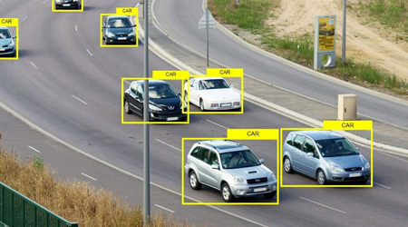
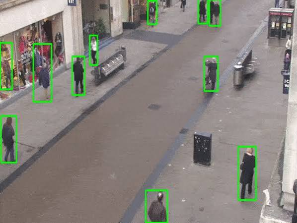
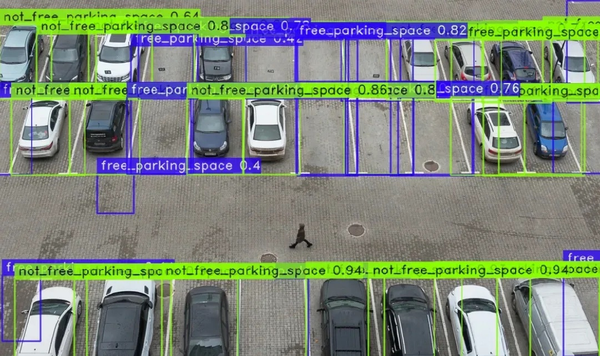
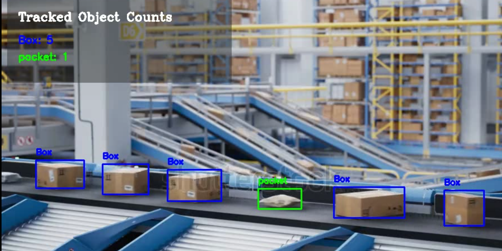
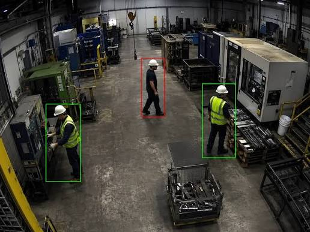
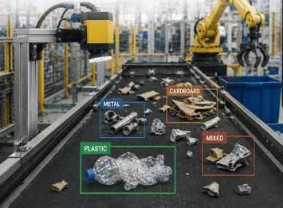
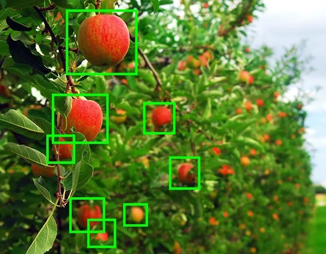
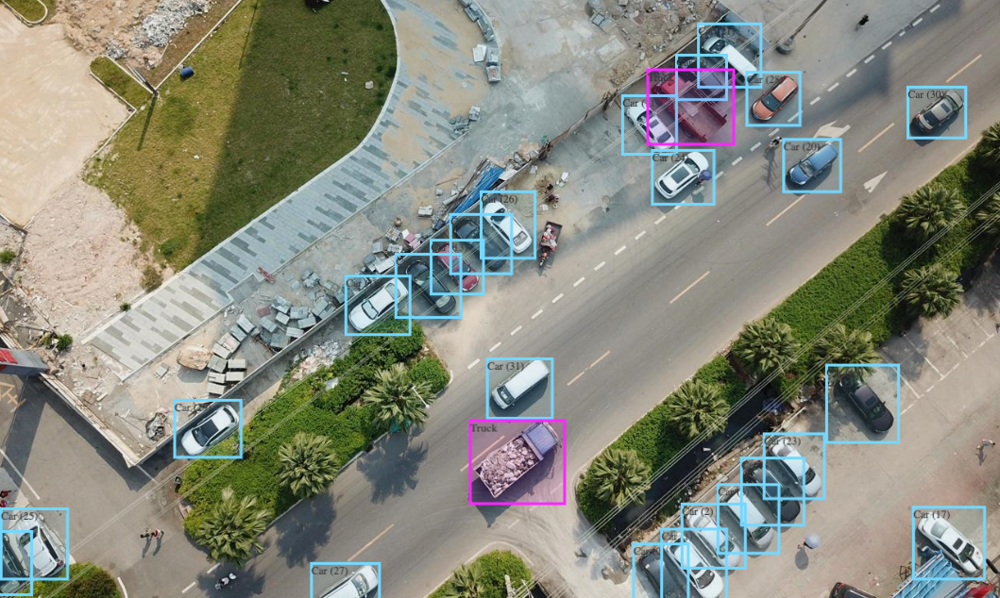
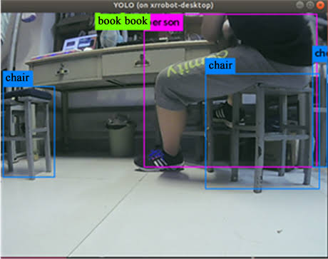

# YOLO обзор

---

## До YOLO: почему детекция была сложной?

Классический pipeline мог включать:

- поиск регионов-кандидатов
- извлечение признаков
- классификацию каждого региона
- объединение и очистку предсказаний

Примеры этапов развития:

- Viola–Jones - эффективное обнаружение лиц в ограниченных условиях
- HOG + SVM - ручные признаки и классификатор
- R-CNN - регионы-кандидаты и CNN
- Fast/Faster R-CNN - ускорение и обучение отдельных частей pipeline (разивается и остается также хороших вариантом, был момент, когда была выше точность, особенно на мелких объектах)

Главная идея эпохи YOLO: свести детекцию к единому обучаемому предсказанию по всему изображению

---

## 2016: «You Only Look Once»

YOLOv1 - статья Joseph Redmon, Santosh Divvala, Ross Girshick и Ali Farhadi, CVPR 2016

Ключевой тезис оригинальной работы:

- одна нейросеть обрабатывает всё изображение
- за один проход предсказывает рамки и классы
- весь pipeline можно оптимизировать end-to-end
- скорость становится частью дизайна, а не только последующей оптимизации

Авторы сообщали до 45 FPS для базовой модели и 155 FPS для Fast YOLO в условиях своего эксперимента

> *Our unified architecture is extremely fast. Our base YOLO model processes images in real-time at 45 frames per second. A smaller version of the network, Fast YOLO, processes an astounding 155 frames per second while still achieving double the mAP of other real-time detectors*

Источник: [оригинальная статья CVPR 2016](https://arxiv.org/pdf/1506.02640)

---

## Важный компромисс уже в YOLOv1

 

Оригинальная статья отмечала характерный профиль ошибок:

- модель была быстрой
- чаще ошибалась в точной локализации объектов
- реже путала фон с объектом по сравнению с рядом систем того времени
- могла хуже справляться с близко расположенными мелкими объектами

Это важный урок компьютерного зрения:

> Ускорение - не бесплатное улучшение. Оно меняет распределение ошибок и то, какие задачи модель решает хорошо

---

## Хронология: это не одна линейная ветка

| год | версия | что именилось |
| --- | --- | --- |
| 2016 | YOLOv1 | единая детекция |
| 2017 | YOLOv2/9000 | улучшение точности и масштаба классов |
| 2018 | YOLOv3 | многоуровневые предсказания |
| 2020 | YOLOv4+5 | разные команды и реализации, для v5 - реализация на PyTorch |
| 2022 | YOLOv6+7 | оптимизация скорости и точности |
| 2023 | YOLOv8 | широкий multi-task workflow |
| 2024 | YOLOv9+10+11 | тест идей на сохранение информации в глубоких слоях |
| 2026 | YOLOv26 | NMS-free mode, end-to-end |

---

## Хронология: это не одна линейная ветка

 

YOLO развивается с 2015 года (написана статья, опубликована в 2016)

Не все версии имеют одного автора или общий код. Название YOLO стало семейством идей, реализаций и брендов

Нумерация не является строгой академической последовательностью. YOLOv5, YOLOv6, YOLOv7, YOLOv8, YOLOv9, YOLOv10 и YOLO11 создавались разными командами. Их нельзя считать просто релизами одного официального репозитория

Помимо этого появлялись другие модификации с "YOLO" в названиях, например, YOLOX, LibreYOLO, PP-YOLOE, DAMO-YOLO и другие

---

## От YOLOv2 до YOLOv4: эволюция инженерных решений

 

- YOLOv2 / YOLO9000 (2017): anchor boxes, batch normalization, multi-scale training; попытка совместить детекцию и большое число классов
- YOLOv3 (2018): Darknet-53 (backbone для первичного обнаружения объектов) и предсказания на нескольких масштабах - особенно важны для объектов разного размера
- YOLOv4 (2020): набор практических архитектурных и обучающих улучшений, включая CSP-подходы (cross-stage partial) и эффективные аугментации

**Общий тренд**: не только «глубже сеть», но и лучшее сочетание backbone, multi-scale features, loss, аугментаций и аппаратного исполнения

- - -

Anchor box - заранее заданный шаблон рамки с фиксированными шириной и высотой. Сеть предсказывает не рамку «с нуля», а то, как нужно подправить этот шаблон, чтобы он точно лёг на объект. Идея была популярна в ранних версиях YOLO, в более поздних перешли к anchor-free подходу, где шаблоны уже не нужны

---

## YOLOv5 и экосистема разработчика

 

В 2020 году Ultralytics выпустила YOLOv5 как удобную PyTorch-ориентированную реализацию

Почему это имело большое значение:

- простой API и CLI
- понятный цикл train / validate / predict / export
- предобученные веса и конфигурации разных размеров
- интеграция с обычным Python workflow
- быстрый путь от ноутбука к прикладному прототипу

Популярность формируется не только за качество прогоноза, но и за счет документации, воспроизводимости, экспорта и удобство команды

---

## 2022–2024: несколько веток развития

- YOLOv6: ориентирован на промышленные сценарии и производительность
- YOLOv7: исследовательские методы повышения эффективности обучения
- YOLOv8 (2023): единый workflow для детекции, сегментации, позы и других задач
- YOLOv9 (2024): Programmable Gradient Information (PGI) и GELAN
- YOLOv10 (2024): end-to-end детекция без традиционного NMS в предложенной архитектуре
- YOLO11 (2024): следующее поколение Ultralytics с улучшениями точности и эффективности

Это не рейтинг «от плохого к хорошему»: старые модели могут быть рациональнее из-за уже проверенного production-пайплайна. Утверждение, что каждая новая версия лучше во всех режимах - неверное. Нужно сравнивать конкретные размеры моделей, датасеты, аппаратное обеспечение и версии runtime

- - -

PGI - схема обучения, которая даёт основной ветке обучени более надежные градиенты. Схема состоит из 3 частей: основная, вспомогательная обратимая и ветка с многоуровневой вспомогательной информацией. В инференсе участвует только основная ветка

GELAN (Generalized Efficient Layer Aggregation Network) - CSPNet (делит поток признаков на 2 части: одна проходит через блоки, а другая идёт напрямую) + ELAN (продуманно организует пути градиентов)

---

## На осень 2026: что считать актуальным?

 

В экосистеме Ultralytics YOLO26 выпущен в январе 2026 года. Документация описывает:

- end-to-end inference без NMS
- более лёгкую detection head и DFL-free regression
- варианты n / s / m / l / x
- задачи detection, segmentation, pose, classification, OBB (Oriented Bounding Box) и другие
- экспорт в ONNX, TensorRT, CoreML, LiteRT и OpenVINO

YOLO11, YOLOv8, YOLOv9/YOLOv10 также остаётся вариантом для стабильных production-систем

- - -

NMS (Non-Maximum Suppression, «подавление не максимумов») - шаг постобработки, который убирает дублирующиеся рамки вокруг одного и того же объекта

DFL (Distribution Focal Loss) - способ делать предсказания не одним числом, а распределением вероятностей

---

## Что значит «фреймворк YOLO»?

Полезно разделять четыре слоя:

1. Идея / семейство архитектур: однопроходная детекция и её дальнейшие варианты
2. Конкретная модель: например, YOLO11n или YOLO26s
3. Инструментарий: загрузка данных, обучение, метрики, аугментации, CLI / API
4. Deployment stack: PyTorch, ONNX Runtime, TensorRT, OpenVINO, CoreML и целевое устройство

Проблема часто не в самой модели, а на стыках: preprocessing, экспорт, типы данных, latency, управление версиями и мониторинг

Разницу между архитектурой и фреймворком:
- архитектура - устройство модели
- фреймворк - код и инструменты для обучения, проверки, инференса и экспорта

В разговорной речи «YOLO» часто обозначает оба понятия

---

## Как устроен типичный YOLO-детектор?

 

- Image 
- Preprocessing 
- Backbone: извлекает визуальные признаки
- Neck: объединяет признаки разных пространственных масштабов / слияние масштабов
- Head: выдаёт предсказания для целевых задач (рамки и классы)
- Postprocessing: фильтрует и преобразует сырые предсказания в итоговые результаты
- Рамки, классы, confidence

Пайплайн больше концептуальный, тк от версии к версии могут различаться компоненты, например, backbone, neck, число уровней, head, postprocessing

---

## Почему нужны признаки разных масштабов?

 

Объекты на кадре могут занимать:

- несколько пикселей - удалённый пешеход
- десятки или сотни пикселей - человек на среднем плане
- большую часть изображения - автомобиль рядом с камерой

Слишком грубая карта признаков теряет детали маленьких объектов. Слишком высокая разрешающая способность дорога по вычислениям

В реальности увеличить размер изображения (по пикселям) может помочь мелким объектам, но повышает вычислительную стоимость. Иногда лучше добавить качественные данные или изменить ракурс камеры, чем просто увеличивать сеть / разрешенность

---

## От изображения к рамкам

 

Один из распространённых форматов bbox:

$$(x_c, y_c, w, h)$$

, где координаты нормированы на ширину и высоту изображения.

Пример: `0.5 0.5 0.2 0.4` означает рамку по центру кадра шириной 20% и высотой 40%.

Часто используемый формат метки YOLO:
> `class_id (index) x_center y_center width height`

Координаты нормированы в диапазоне 0–1. Точный формат зависит от инструмента и задачи

---

## Anchors, anchor-free и NMS

 

**Anchors:** предопределённые формы рамок, относительно которых модель учится уточнять предсказание

**Anchor-free:** модель предсказывает положение объектов без классического набора anchor boxes. Это не означает «без сетки» или «без постобработки»

**NMS (Non-Maximum Suppression):** подавляет сильно перекрывающиеся рамки, оставляя наиболее подходящие

**NMS-free / end-to-end:** архитектура обучается так, чтобы не требовать традиционной NMS-процедуры в обычном inference path (YOLOv10, YOLO26)

Убирание NMS может упростить и ускорить pipeline, но не гарантирует автоматического выигрыша на любом устройстве и датасете

---

## Обучение: что оптимизирует модель?

Обучение сопоставляет предсказания с разметкой. Обычно учитываются несколько составляющих:

- Localization / box loss: насколько рамка совпадает с ground truth
- Classification loss: верно ли определён класс
- Objectness / confidence-related loss: в версиях, где это предусмотрено, насколько предсказание соответствует объекту

Комбинация и точная формула меняются между версиями. Обучение также зависит от:
- качества и согласованности разметки
- размера и баланса датасета
- аугментаций
- разрешения входа
- optimizer, learning rate и расписания обучения

Архитектура - лишь одна часть качества. Ошибки разметки и несовпадение train/test доменов часто сильнее влияют на результат, чем смена модели

---

## Transfer learning: почему не начинать с нуля?

 

Типичный практический путь:

- взять pretrained weights
- заменить число классов под задачу
- дообучить на собственном датасете
- проверить качество на независимой val / test выборке
- протестировать на реальных фото / видео и крайних случаях

Предобучение помогает использовать уже выученные визуальные признаки. Но оно не гарантирует устойчивости к новой камере, погоде, освещению или редким объектам

В качестве примера, модель обучена на обычных фотографиях автомобилей, а в продукте работает на ночной камере с бликами. Формально классы те же, но распределение изображений другое

---

## Метрики: как понять, что модель хороша?

- IoU - отношение площади пересечения двух рамок к площади их объединения
- Precision - какая доля предсказанных объектов действительно верна
- Recall - какую долю истинных объектов модель обнаружила
- AP - площадь под precision–recall кривой для класса
- mAP - усреднение AP по классам и/или порогам IoU, в зависимости от протокола
- Latency / FPS - задержка одного запроса / число обработанных кадров в секунду

Для COCO часто приводят `mAP@[0.50:0.95]`: AP усредняется по IoU-порогам от 0.50 до 0.95

Как читать результаты:
- Высокий `mAP@0.5` при низком `mAP@[0.50:0.95]` означает, что модель объекты находит, но рамки неточные. Могут помочь больше данных, более аккуратная разметка или модель покрупнее
- Если важно только «есть ли объект» (подсчёт, обнаружение присутствия), хватит `mAP@0.5`
- Если рамки нужны для измерений, обрезки или трекинга, смотрим на `mAP@[0.50:0.95]`

`mAP@0.5` = `mAP50` &nbsp;&nbsp;&nbsp;&nbsp; `mAP@[0.50:0.95]` = `mAP@[.50:.95]` = `mAP50-95`

---

## IoU на пальцах

$$ IoU = \frac{|B_{pred} \cap B_{gt}|}{|B_{pred} \cup B_{gt}|} $$

- `IoU = 1.0`: идеальное совпадение рамок
- `IoU = 0.0`: рамки не пересекаются

IoU превращает предсказания в TP или FP. Мы задаём порог IoU. Предсказание считается верным (TP), если IoU с эталоном не меньше порога, и ложным (FP) в противном случае. Дубликат уже найденного объекта тоже FP

Например, `IoU = 0.65` при пороге 0.5 это TP, а при пороге 0.75 это FP

Чем выше порог IoU, тем точнее должна быть локализация:

> <pre>Ground truth:  [----------------]</pre>
> <pre>Prediction:       [----------------] </pre>
> <pre>               |xx|   overlap   |xx|</pre>

---

## Скорость: FPS — не вся история

 

На итоговую задержку влияют:

- размер модели и входного изображения
- GPU / CPU / NPU и пропускная способность памяти
- batch size
- precision: FP32, FP16, INT8
- preprocessing и postprocessing
- формат модели и runtime
- передача кадров, декодирование видео и очереди

Практический пример: модель может давать 100 FPS в чистом GPU benchmark, но система целиком - 25 FPS из-за декодирования RTSP, копирования памяти, инференса и записи результатов

Сравнивайте latency на целевом устройстве, а не только таблицы из разных статей

---

## YOLO и альтернативы

| Подход | Сильные стороны | Ограничения / когда проверить альтернативу |
| --- | --- | --- |
| YOLO (разные семейства) | Скорость, удобный workflow, много deployment-путей | Качество зависит от версии, размера и домена |
| Faster R-CNN | Зрелый 2-этапный baseline, полезен для сравнений | Часто ↑ задержка и сложнее добиться real-time |
| DETR / Deformable DETR | Transformer-подход, set prediction; меньше классической NMS-логики | Вычислительная стоимость и особенности обучения зависят от варианта |
| RT-DETR | Transformer-детектор, ориентированный на real-time | Нужно измерять скорость и качество на своём железе |
| RF-DETR / D-FINE и другие новые модели | Могут показывать сильный AP в конкретных бенчмарках | Сравнения зависят от протокола, размера и реализации |

---

## Как читать бенчмарки без самообмана

 

Прежде чем верить цифре, оцениваем:

- На каком датасете и split измеряли?
- Какая метрика: `mAP@0.5` или `mAP@[0.50:0.95]`?
- Каковы размер модели и входное разрешение?
- Какое устройство и runtime использовались?
- Включены ли preprocessing и postprocessing?
- Одинакова ли точность вычислений?
- Кто проводил тест - независимая сторона или разработчик модели?

---

## Почему YOLO так популярен?

 

- Низкий порог входа: короткий Python-код и CLI
- Предобученные модели: быстрый baseline до обучения собственной модели
- Скорость: много вариантов от nano до крупных
- Экспорт: распространённые форматы и аппаратные runtime
- Экосистема: туториалы, инструменты разметки, интеграции и сообщество
- Мультизадачность: в современных семействах - сегментация, поза, OBB и другие задачи

Популярность - это сочетание качества, удобства, доступности инструментов и стоимости внедрения

Но, популярность решения всего лишь повышает шанс найти примеры, решения проблем и специалистов, но не заменяет требования конкретной задачи. В этом разница различие между «популярен» и «лучший»

---

## Ограничения и типичные сбои

 

YOLO может ошибаться при:

- очень маленьких, перекрытых или частично видимых объектах
- плохом освещении, размытии и сильных бликах
- доменном сдвиге: другая камера, регион, сезон, стиль изображения
- редких классах и дисбалансе данных
- плотных сценах, где объекты сильно перекрываются
- требованиях к точным границам, когда нужна сегментация вместо bbox

---

## Применение: транспорт и умные города

 

- подсчёт транспортных средств по полосам
- оценка загруженности перекрёстка
- обнаружение пешеходов и велосипедистов
- контроль парковочных мест
- обнаружение остановившегося транспорта или препятствий - вместе с логикой событий
- трекинг траекторий для статистики потоков

<table>
<tr style="width=100%;">
<td align="center">

</td><td align="center">

</td><td align="center">

</td>
</tr>
</table>

---

## Применение: промышленность и логистика

 

- наличие каски, жилета или перчаток в зоне работ
- контроль комплектности изделия
- подсчёт коробок и деталей на конвейере
- обнаружение повреждений упаковки
- контроль заполнения паллет
- подсчёт продукции и анализ очередей на линии

<table>
<tr style="width=100%;">
<td align="center">

</td><td align="center">

</td><td align="center">

</td>
</tr>
</table>

---

## Применение: агро, экология и робототехника

- обнаружение плодов для оценки урожая
- подсчёт растений или животных
- поиск объектов на аэрофотоснимках
- обнаружение препятствий на мобильном роботе
- поиск предметов для pick-and-place
- детекция объектов в видео с дронов

Для дронов и аэрофотоснимков особенно важны мелкие объекты, высокая плотность сцен, поворотные рамки (OBB) и корректная обработка больших изображений. Но детектор не даёт автоматически точное расстояние до объекта. Для метрического расстояния нужны дополнительные предположения, калибровка, стерео, глубина или другая сенсорная информация

<table>
<tr style="width=100%;">
<td align="center">

</td><td align="center">

</td><td align="center">

</td>
</tr>
</table>

---

## Применение: люди, спорт и интерактивные системы

 

- подсчёт людей и оценка очередей
- трекинг игроков и анализ спортивных эпизодов
- оценка позы для фитнес-приложений
- контроль занятости рабочих зон
- жесты и движение - часто в сочетании с pose estimation и temporal models

Технические границы:
- обнаружение человека != идентификации личности
- pose estimation не гарантирует понимания действия
- ошибки зависят от ракурса, одежды, перекрытий и состава данных

---

## Выбор модели: начать с требований, а не с номера версии

 

- Какие классы и какие ошибки критичны?
- Какого размера объекты и насколько плотная сцена?
- Нужны bbox, маски, keypoints или ориентированные рамки?
- Какова допустимая end-to-end задержка?
- Где работает система: CPU, GPU, Jetson, мобильный NPU?
- Можно ли отправлять кадры в облако или нужен edge inference?
- Каковы бюджет, лицензия и требования к сопровождению?

Правило: сначала зафиксировать метрики успеха и ограничения, затем выбрать модель и размер

---

## Отладка качества: что делать, если модель ошибается?

 

| Симптом | Что проверить |
| --- | --- |
| Не видит мелкие объекты | Разрешение, масштаб данных, баланс маленьких объектов |
| Ложные срабатывания | Качество разметки, confidence threshold |
| Ошибки на ночных кадрах | Репрезентативные ночные данные, экспозиция и шум |
| Путает похожие классы | Определения классов, неоднозначные метки, больше примеров |
| Хорошо на val, плохо в "поле" | Утечки, domain shift, реальные камеры и preprocessing |
| Не укладывается в latency | Runtime, batch, precision, размер модели, профиль pipeline |

Всегда смотрим на примеры ошибок, а не только на итоговый mAP

---

## Deployment: модель - только часть системы

 

Перед выпуском замеряем:

- end-to-end latency
- потребление памяти и мощность
- поведение при пропусках кадров и сетевых сбоях
- стабильность на новых условиях
- версию весов, кода, runtime и preprocessing

А также: 
- логирование версий
- статистики ошибок

Помним, что иногда изменение resize или цветового порядка RGB/BGR может повлиять на качество не меньше, чем изменение модели

---

## Лицензия и ответственное использование

Перед коммерческим внедрением проверяем:

- лицензию исходного кода, весов и зависимостей
- условия использования и распространения модели
- права на обучающие данные и изображения
- требования к персональным данным и видеонаблюдению
- риски автоматизированных решений и процедуру человеческой проверки

Для Ultralytics важно изучить актуальные условия лицензирования на официальном сайте: документация и лицензионная информация. **Техническая возможность обнаружить объект не означает, что любое применение допустимо**

Популярная лицензия в "мире" YOLO на сегодняшний день - AGPL-3.0, которая обязывает открывать код, либо покупать лицензию, которая снимет ограничения на открытие связанного кода. Делать закрытый коммерческий проект, используя наработки Ultralytics без платной лицензии нельзя

Лицензия должна быть отдельно проверена для кода, для предобученных весов модели, датасета. Лицензии меняются от релиза к релизу. Детали необходимо уточнять у юридического отдела

---

## Главные выводы

 

- YOLO изменил детекцию, сделав единый быстрый проход центральной идеей
- YOLO - семейство моделей и инструментов, а не одна неизменная архитектура
- Скорость, точность локализации, качество на мелких объектах и стоимость - взаимосвязанные компромиссы
- Популярность поддерживают экосистема, предобученные веса и простой deployment workflow
- В реальном проекте данные, метрики и целевое оборудование важнее модного номера версии
- Детекция - компонент системы; для событий и действий часто нужны трекинг, временная логика и дополнительные модели

Три первых вопроса перед выбором модели:

- какую задачу решаем?
- какова цена ошибки?
- где будет работать система? 

---
