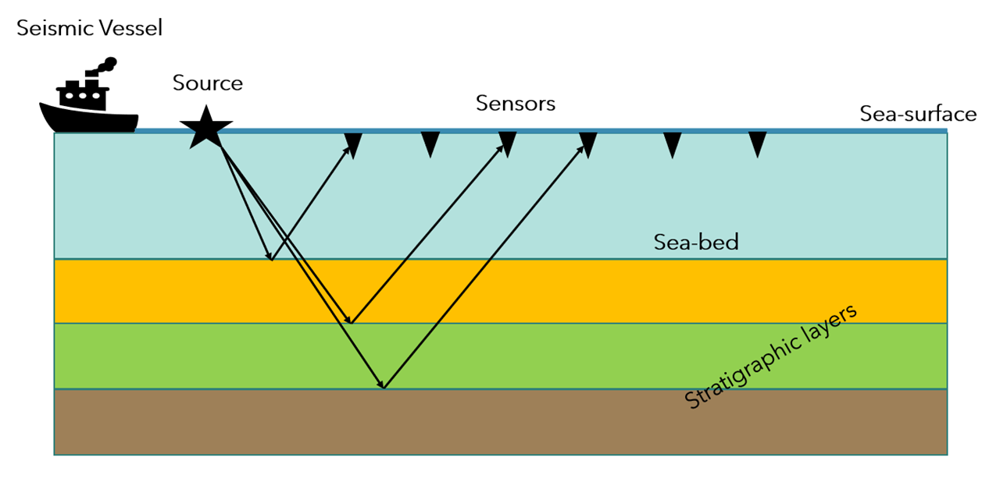
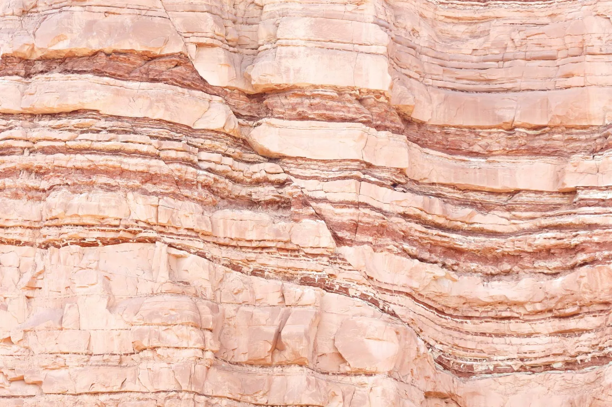
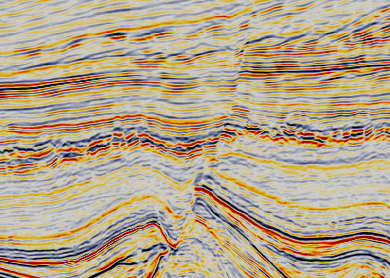
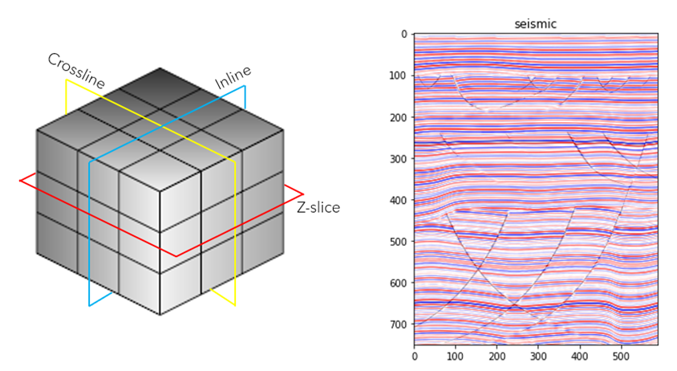
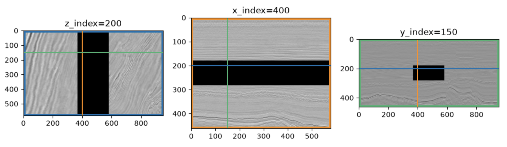

## Самостоятельная работа
(до 29.11.2026 включительно)

---

## Доменная область

**Сейсморазведка** - один из геофизических методов исследования строения земной коры, основанный на изучении того, как распространяются упругие волны в нижнем полупространстве

Источник колебаний создает упругую волну, датчики на поверхности земли (либо воды) фиксируют колебания, отраженные от границ сред. Некоторые волны отражаются, некоторые - преломляются. В данном случае нас будут интересовать: время пробега волны и амплитуда колебания

Обычно данный метод сравнивают с ультразвуковым исследованием в медицине, либо то, как устроено "зрение" у летучих мышей или дельфинов (эхолокация)

---

## Реальная картина vs картина данных сейсморазведки

 

<table>
<tr>
<td style="width:50%;" align="center">
геологический разрез
</td>
<td style="width:50%;" align="center">
данные сейсморазведки
</td>
</tr>
<tr>
<td style="width:50%;" align="center">

</td>
<td style="width:50%;" align="center">

</td>
</tr>
</table>

Это не один и тот же разрез, цель - показать, что слоистость, наличие разломов, их положение по данным сейсморазведки можно определить, но выглядеть это может слегка по-другому

---

## Inline, xline (crossline), z-slice

 

---

## Insted of inline, xline (crossline), z-slice

 

---

## Описания кубов

**inpainting cube:**
  - размеры: 580 x 951 x 462
  - суммарно скрыто ~5% входных данных [:, 368:581, 179:282]
  - sha256(inpainting_cube_missed_data.npy): 1aa956cfb12a75536ddd815f5d6f21abfbcccf474aec6de0d0a04c76b6eab1e5

 

**outpainting cube:**
  - размеры: 460 x 481 x 800
  - суммарно скрыто ~10% входных данных [:, |0:24|+|457:481|, :]
  - sha256 (outpainting_cube_missed_data.npy): b33681e31f22c7cfa21de6b96f17e640a981f3ead16579b0656f063a4b9231fa

[ссылка на скачивание](https://disk.yandex.ru/d/JRT1Q5WP3NzGMQ)

---

## Задание - восстановить недостающие участки

 

оцениваться будет (на каждый куб свое решение):
  - подготовка датасета
  - модель
  - пайплайн обучения и инференса
  - оценка будет производиться по R (наиболее часто встречающаяся метрика для данных сейсмики) по восстановленным участкам

**Для генерации тренировочного датасета можно использовать только тот куб, в котором отсутствуют данные, использовать данные одного куба для восстановления недостающих данных другого куба нельзя**

**Использовать сторонние данные для создания датасетов нельзя. Ограничьтесь только этими входными файлами**